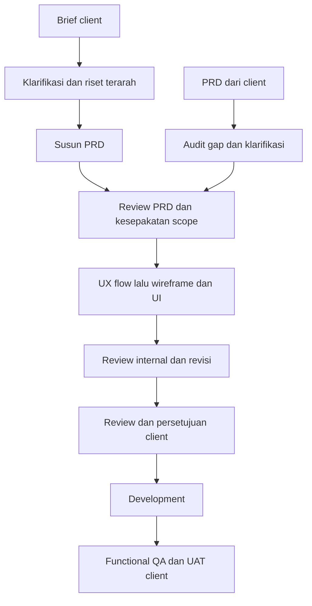

# Product workflow untuk Codex

Setup personal untuk website dan mobile apps: orchestrator sebagai Product Lead/pemilik PRD, researcher kritis, UI/UX designer, dan reviewer/QA independen. Skill mandiri `frontend-engineer` menangani ticket frontend harian. Sumber konfigurasi disimpan di repo ini; pemasangan personal membuatnya dapat digunakan dari proyek lain.

## Peran dan skill

| Profil agent | Skill | Tanggung jawab |
| --- | --- | --- |
| `product_orchestrator` | [`product-orchestrator`](skills/product-orchestrator/SKILL.md) | Brief, sintesis riset, PRD, scope, delegasi dan handoff |
| `product_researcher` | [`critical-product-research`](skills/critical-product-research/SKILL.md) | Bukti, kontra-bukti, asumsi dan implikasi keputusan |
| `product_designer` | [`product-ui-ux`](skills/product-ui-ux/SKILL.md) | Flow, wireframe, arah visual, states dan adaptasi platform |
| `product_reviewer` | [`product-review-qa`](skills/product-review-qa/SKILL.md) | Kesiapan PRD, review desain, functional QA dan retest |
| Tanpa profil khusus | [`frontend-engineer`](skills/frontend-engineer/SKILL.md) | Delivery ticket frontend dalam mode `task`, `bugfix`, `feature`, atau `refactor` |

Skill memuat workflow. Empat profil TOML memberi mandat peran dan meminta agent membaca skill pasangannya; `frontend-engineer` dipakai langsung tanpa profil kelima. Semua profil mengikuti model, reasoning, izin dan tool sesi induk; setup ini tidak menetapkan model atau menambah akses layanan.

## Alur produk client



Masuk pada tahap yang sesuai artefak dan persetujuan yang sudah ada. Riset dan audit independen dapat paralel; desain dapat mengungkap pertanyaan requirement baru. Perubahan material kembali ke Product Lead dan dicatat pada sumber aktif proyek. Reviewer internal memberikan rekomendasi; penerimaan client dicatat dari keputusan client yang nyata.

## Pasang personal

Prasyarat: Python **3.11+** dan Codex yang mendukung skill/custom agents. Installer memakai standard library; PyYAML hanya diperlukan untuk validasi pengembangan repo.

Jalankan dari checkout repo:

```sh
python3 scripts/install.py --dry-run
python3 scripts/install.py --apply
```

Di Windows, gunakan interpreter Python 3.11+ yang tersedia, misalnya `py -3.11` sebagai pengganti `python3`.

Default tujuan mengikuti `CODEX_HOME` jika disetel, atau `~/.codex`:

- Empat profil di `agents/`.
- Lima skill beserta referensinya di `skills/`.
- Manifest kepemilikan file dan backup upgrade di `product-workflow/`.

Untuk memakai direktori skill personal lain yang ditemukan Codex, misalnya `~/.agents/skills`, berikan `--skills-home`. `--codex-home` dapat dipakai untuk instalasi terisolasi. Simpan pilihan lokasi yang sama ketika memperbarui.

Installer memeriksa semua konflik sebelum menulis, mempertahankan file lain, dan tidak mengubah `config.toml` atau `AGENTS.md` personal/proyek. File dengan isi identik dibiarkan. Upgrade file yang sebelumnya dipasang hanya dilakukan ketika hash-nya masih sesuai manifest, dengan backup versi sebelumnya. Edit lokal yang berbeda akan dilaporkan sebagai konflik untuk direkonsiliasi.

Pembaruan: perbarui checkout sumber, periksa perubahan, lalu jalankan dry-run dan apply kembali. Edit sumber di repo sebagai tempat pemeliharaan; salinan personal adalah hasil pemasangan.

## Mulai di chat proyek

### Brief, PRD, dan desain produk

Buka chat utama di folder/repo proyek client, lalu salin template sesuai tahap:

1. [Brief baru dari client](skills/product-orchestrator/references/templates/brief-baru.md) — riset, PRD, desain, dan review internal hingga siap review client.
2. [PRD dari client](skills/product-orchestrator/references/templates/prd-client.md) — audit gap dan desain dengan mempertahankan baseline serta persetujuan existing.
3. [Lanjut development](skills/product-orchestrator/references/templates/lanjut-development.md) — implementasi, functional QA, dan persiapan UAT setelah scope/desain disetujui.

Ganti bagian bertanda kurung siku dengan konteks proyek. Tulis “belum ditentukan” untuk informasi yang belum tersedia; isi status persetujuan berdasarkan keputusan yang benar-benar diberikan. Ketiga template memanggil `$product-orchestrator` dan ikut terpasang bersama referensi skill saat installer dijalankan.

Profil `product_orchestrator` digunakan ketika koordinasi itu sendiri didelegasikan; membuat profil tidak otomatis mengubah chat utama menjadi orchestrator. Skill pada chat utama yang mengaktifkan workflow. Pemilihan profil custom bergantung pada client/tool; skill juga memberi fallback delegasi dengan mandat peran yang sama.

Panduan memilih template dan pemanggilan specialist ada di [referensi penggunaan](skills/product-orchestrator/references/start.md). Jika skill/profil belum muncul, mulai chat baru atau restart Codex lalu periksa kembali. Jangan menganggap file terpasang sebagai bukti bahwa setiap client telah memuatnya.

### Ticket frontend harian

Gunakan [`frontend-engineer`](skills/frontend-engineer/SKILL.md) untuk tugas implementasi yang sudah memiliki ticket atau kebutuhan jelas, termasuk pekerjaan perusahaan. Ticket, AC, desain, dan otorisasi yang berlaku menjadi baseline; discovery/PRD serta persetujuan client mengikuti kebutuhan pekerjaan dan aturan proyek, bukan gate universal untuk ticket yang sudah disetujui.

```text
Gunakan $frontend-engineer.
Mode: bugfix
Ticket: [ID/lokasi, gejala, dan perilaku yang diharapkan]
```

Pilih template sesuai pekerjaan:

- [Task](skills/frontend-engineer/references/templates/task.md): tugas frontend dengan hasil yang sudah ditentukan.
- [Bugfix](skills/frontend-engineer/references/templates/bugfix.md): reproduksi masalah, perbaikan, dan pemeriksaan regresi.
- [Feature](skills/frontend-engineer/references/templates/feature.md): implementasi fitur sesuai kebutuhan dan pola proyek.
- [Refactor](skills/frontend-engineer/references/templates/refactor.md): perbaikan struktur dengan perilaku yang tetap terjaga.

Alurnya: **ticket → investigasi → implementasi → validasi → review sesuai risiko → siap PR**. Review independen digunakan ketika risiko atau aturan proyek membutuhkannya. Hasil mencakup perubahan, bukti validasi aktual, dan batas verifikasi untuk reviewer; commit, push, atau pembuatan PR mengikuti mandat tugas.

## Cara menilai hasil

- Researcher membedakan fakta, pernyataan client, interpretasi, hipotesis dan gap. Riset internet tidak menggantikan data pengguna.
- Designer mendasarkan arah visual pada pengguna, konten, brand dan platform. Modern/anti-slop dinilai lewat keputusan yang kontekstual, tanpa larangan gaya universal. Skill desain proyek yang wajib tetap berlaku; `impeccable` dapat digunakan bila tersedia, sesuai scope, dan prasyaratnya dipenuhi.
- Reviewer memberi bukti dan cakupan aktual. Build atau screenshot web tidak membuktikan interaksi native, save/reload, screen reader, atau pengalaman pengguna nyata.
- Frontend engineer memenuhi ticket/AC, mengikuti pola proyek, dan melaporkan pengujian serta batasnya; kedalaman validasi dan review mengikuti dampak perubahan.
- PRD, hasil riset dan keputusan tetap tinggal pada sumber aktif proyek. Setup personal ini tidak mengumpulkan dokumen client ke repo konfigurasi.
- Integrasi Figma/browser/backend/simulator/perangkat digunakan hanya bila tersedia dan diotorisasi. Setup ini tidak menghubungi client atau mempublikasikan hasil secara otomatis.

## Validasi pengembangan setup

```sh
python3 -m pip install -r requirements-dev.txt
python3 scripts/validate.py
python3 -m unittest discover -s tests -v
```

Validator memeriksa TOML, frontmatter/metadata YAML, pasangan empat profil-skill, skill mandiri, dan referensi lokal. Test installer berjalan dalam direktori sementara; tidak menulis konfigurasi personal. Pemeriksaan perilaku skill tetap memerlukan contoh tugas nyata dan review independen, termasuk mode frontend serta penanganan bukti QA yang belum tersedia.

Format mengikuti dokumentasi resmi [Subagents](https://learn.chatgpt.com/docs/agent-configuration/subagents) dan [Build skills](https://learn.chatgpt.com/docs/build-skills). Kapabilitas dapat berbeda antar client/versi Codex.
